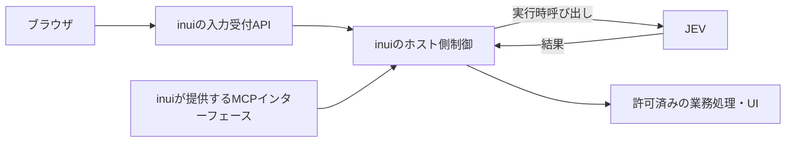

# ADR-0001: MVPの技術構成と運用方針を決定する

- 状態: 一部決定。フロント・API実行基盤・DB・GitHub Actions・ECRの利用方針・MCPとJEVの役割・アプリ側のアクセス制御は合意済み。GatewayはOSSの自己管理負担を理由に見直し提案中で、AWS API Gateway + Lambdaを推奨案とする。新しい入口の採用は未確定。Konnectは保留する。
- 記録日・料金確認日: 2026-10-30
- 関連: [Issue #2](https://github.com/abi-yusuke-wada/inui/issues/2)、[MVPのスコープ](../../MVP.md)

## 背景と合意済みの条件

- 対象はアンケート回答・指定日の予定参照・個人の表示設定変更の3機能。少人数の研究用MVPを小さく作り切る。
- フロントエンドはReactとTypeScript、APIはTypeScriptとHonoを使う。DBはRDBとしてTurso Cloudを採用する。
- CI/CDにはGitHub Actionsを使い、デプロイ用コンテナイメージの保管先にはAmazon ECRを利用する方針とする。
- inuiがMCPインターフェースを提供する。JEVはinuiのホスト処理から実行時に呼び出す対象とし、外部リソースを使う前提を維持する。
- 基盤費用は会社の個人AWS利用枠で、月2,000円程度を目安にする。正確な利用可能額・既存使用量は未確認。
- LLM・JEVなどのAPIキー利用料は別途相談とし、今回の基盤費用比較から除外する。DB・配信・ログ・Gatewayなどの基盤費用は比較に含める。
- 本業とは別の研究タスクであるため、クラウド料金に加えて構築・デプロイ・CI等の作業時間も費用として評価し、自動化で手間を減らす。増額の可能性はあるが、将来の増額を前提に構成を大きくしない。
- Kong Konnectは部署で強く推奨されているベンダーリソースだが保留する。Kong Gateway OSSを先に使う方針には一度合意したが、Lambda中心のMVPに常駐Gatewayを追加する負担を受け、AWSのマネージドなHTTP入口へ見直す提案を比較する。
- 社内の小さなコミュニティへインターネット経由で配布する。所属部署のGitHub Organizationメンバーだけが利用できるよう、アプリ側で制御する。

## 比較した案と判断理由

### APIの実行基盤

| 案 | 費用・運用のトレードオフ | 現時点の扱い |
| --- | --- | --- |
| AWS Lambda | 通常のオンデマンド実行はリクエスト数・実行時間に応じた課金。サーバ・OSの管理を減らせる。保存先は実行環境の外に用意し、JEVへの通信とinuiが提供するMCPの実装条件を確認する必要がある | 採用。AWSの利用枠を使い、少人数・低頻度のHTTP処理と運用の省力化を優先する |
| Amazon EC2 | 常駐プロセスや同一サーバのRDBを扱いやすい。稼働時間に加え、EBS・公開IPv4等の費用とOS・プロセス管理の手間を比較する必要がある | APIの実行基盤としては不採用。運用の手間を抑えるためLambdaを選ぶ。Gateway用の常駐環境を追加するかも見直し中 |
| さくら AppRun共用型 | Node.jsのコンテナを実行する候補。最小構成は0.5 vCPU・1 GiBで5円/時。ゼロスケールが可能だが、起動・稼働に料金がかかる | 今回は不採用。会社の利用枠があるAWSを使う |

HonoにはLambda向けの公式アダプターがあり、TypeScriptのAPIをLambda上で実行する構成を取れる。Lambdaの採用は確定し、JEV呼び出しとMCPインターフェースの処理時間・通信条件は実装時に確認する。[HonoのLambda対応](https://hono.dev/docs/getting-started/aws-lambda)、[Lambda料金](https://aws.amazon.com/lambda/pricing/)、[Lambdaの管理範囲](https://docs.aws.amazon.com/lambda/latest/dg/lambda-functions-chapter.html)、[EC2料金](https://aws.amazon.com/ec2/pricing/on-demand/)、[AppRun料金](https://cloud.sakura.ad.jp/products/apprun-shared/)

### RDB

| 案 | 費用・運用のトレードオフ | 現時点の扱い |
| --- | --- | --- |
| Turso Cloud | SQLite互換のSQLを扱うマネージドDB。Freeプランから始める候補で、HTTP接続とTypeScript向けクライアントがある。無料枠・SQL互換性・利用するエンジンとクライアントの組み合わせを確認する | 採用。RDBと低予算の条件を満たし、DBサーバの運用を減らせる |
| EC2上のSQLite等 | 同じサーバにデータを保存できるが、EC2本体・ディスクとDB運用を含めて比較する必要がある | 今回は不採用。APIのLambda実行と外部DBを組み合わせる |
| DynamoDB | 先に低予算の保存先候補として挙げたが、RDBの採用方針とは合わない | 不採用 |

Turso Freeの公開料金は月額0 USD、ストレージ5 GB、月間読み取り5億行・書き込み1,000万行。読み取りはSQLの実行で走査した行数も関係し、APIリクエスト数とは異なる。無料枠超過時の制限やOveragesの設定を確認し、追加料金ゼロを無条件に保証しない。[Turso料金](https://turso.tech/pricing?frequency=monthly)、[利用量・課金](https://docs.turso.tech/help/usage-and-billing)

Turso Cloudの採用と、エンジン・ドライバー・ORMの選定は区別する。リモートのTursoエンジン向けには `@tursodatabase/serverless`、libSQL向けには `@libsql/client` があり、後者の `/web` はHTTP接続を使う。公式資料ではORMの対応も異なるため、必要なSQL機能を確認して組み合わせを選ぶ。今回は依存関係を追加しない。[TypeScript接続](https://docs.turso.tech/sdk/ts/quickstart)、[SQL over HTTP](https://docs.turso.tech/sdk/http/quickstart)

### LambdaとTursoの接続方針

公式資料では、Tursoのリモート接続クライアントはAWS Lambdaを含むサーバレス環境に対応している。AWS専用のDB連携機能を用意するのではなく、Honoの業務処理からDBのURLとTursoの認証トークンを使ってHTTPS経由でSQLを実行する構成を取れる。[TypeScriptクライアント仕様](https://docs.turso.tech/sdk/ts/reference)

- Amplify HostingがReactの静的ファイルをブラウザに配信し、ブラウザは入力をHono / Lambdaの受付APIへPOSTする。ホスト側でJEVを実行時に呼び出し、判断結果を検証して許可済みの業務処理・UIを選択する。MCPはinuiが提供するインターフェースとして扱う。
- 「APIの入口」は、外部から受付APIへリクエストを届ける公開URL・HTTP接続経路を指す。Kong OSSの採用方針は見直し提案中で、AWS API Gateway + Lambdaを推奨案とし、Function URLも比較する。受付後のIntent判定・業務処理と区別し、認証情報の受け渡し等の設定は実装時に決める。
- Lambda側でIntent・Tool・引数を検証し、許可した業務処理から必要なSQLを実行する。ブラウザからDBへ直接接続せず、DBの認証情報はLambda側で管理する。秘密情報の保管・注入方法は別途決める。
- 通常のLambda関数は、自分たちのVPCへ接続する設定を追加しなければ外部インターネットへ接続できる。Tursoへ接続するだけの目的でVPCやNAT Gatewayを追加する必要はない。会社のネットワーク要件がある場合は、その条件と追加費用を確認する。[Lambdaの外部通信](https://docs.aws.amazon.com/lambda/latest/dg/configuration-vpc.html)
- DBの採用は確定し、実際の接続は未検証とする。構築時に、Lambdaからの読み書き・再取得、同時更新、必要なトランザクション、タイムアウト・再試行時の保存結果を確認する。DB配置と通信時間、無料枠内の利用量も検証する。

オーケストレーションはホスト側で行い、DBには業務データを保存する。LLM・JEVとの長い通信をDBトランザクション内に含めない設計を基準に検討する。

### MCPインターフェースとJEVの役割

MCPはinuiが提供するインターフェースであり、inuiがMCP Server側の役割を持つ。JEVはinuiの処理の中で実行時に呼び出す対象とする。MCP自体をIntent判定主体とは扱わず、ホストが判断結果の検証・許可済みの業務処理とUIの制御を担う。

概念上の関係は次のとおり。具体的なルート・公開Tool・MCPを利用する側の構成は未確定。

MCPの公開Tool・入出力・通信方式・SDK対応版と、JEVの具体的な製品・SDK・接続先はIssue #4で具体化する。MCPにはStreamable HTTP等の標準トランスポートがあるが、今回は通信方式やSDKを確定しない。認証・認可と引数の検証は、通常の受付APIとMCPの双方でホスト側に適用する。[MCPの通信方式](https://modelcontextprotocol.io/specification/2026-07-28/basic/transports)

### フロントエンドのホスティング

SSRの要件は現時点でなく、事前実装済みのReact UIをAmplify Hostingで静的配信する。CDNとそのキャッシュ管理はAmplify Hostingが提供するCloudFrontに任せ、別のCDNや自前のCloudFrontディストリビューションは追加しない。今回不採用としたのはS3 + CloudFrontを個別に構築・運用する案である。[AmplifyのCDN・キャッシュ管理](https://docs.aws.amazon.com/amplify/latest/userguide/caching.html)

| 比較項目 | S3 + CloudFront | Amplify Hosting |
| --- | --- | --- |
| 初期構築 | S3への配置、CloudFront、S3へのアクセス制御、キャッシュ等を設定する。調整できる項目が多い分、設定の理解が必要 | Gitリポジトリとビルド設定を接続して配信でき、構築手順をまとめやすい |
| 料金 | 保存・S3リクエスト・配信等を確認する。CloudFront Freeプランが使えれば配信費を抑える候補。ビルド実行先の費用は別に考える | 標準ビルド0.01 USD/分、保存0.023 USD/GB月、転送0.15 USD/GBが無料枠対象外の基準。ビルド・配信が増えると費用が増える |
| 日常の更新 | ビルド成果物のアップロードとキャッシュ更新の手順を用意する。自動化する場合は別途構成する | Git連携でビルド・デプロイを自動化できる。自動ビルドの対象ブランチ・頻度を決める必要がある |
| PRプレビュー | 環境・URL・公開手順を別途用意する | 標準機能でPR・ブランチごとの確認環境を作れる。プレビュー用のビルドも費用に含める |
| 設定の柔軟性 | オリジンやキャッシュ等を直接調整できる | 管理されたHostingの設定範囲で調整する。CloudFrontを直接扱う構成とは設定箇所が異なる |
| HTTPS・独自ドメイン | 証明書・ドメイン・配信設定を組み合わせる | Hostingの機能でドメイン・SSL設定をまとめられる。独自ドメインの登録費用は別に確認する |
| サーバ運用 | 静的配信なのでサーバ・OSの管理は不要。配信設定と更新手順は管理する | 静的配信なのでサーバ・OSの管理は不要。ビルド設定とデプロイ状況は管理する |
| Hono・Tursoとの接続 | UIから呼ぶAPIのURL・通信設定を別途決める | 同様に別途決める。フロントHostingの選択でHono・Tursoを変更する必要はない |

2026-10-30、当初はクラウド料金を優先してS3 + CloudFrontを選ぶ方針だったが、その後の対話でAmplify Hostingへ変更した。S3 + CloudFrontを個別に構築・運用する案は不採用とする。本業と別の研究タスクであり、ビルド・アップロード・キャッシュ更新等の構築と維持にかかる作業時間も含め、Git連携による自動化の利点を優先する。クラウド料金が最小であると実証した判断ではない。[S3 + CloudFrontの構築手順](https://docs.aws.amazon.com/AmazonCloudFront/latest/DeveloperGuide/getting-started-secure-static-website-cloudformation-template.html)、[Amplify Hostingの機能](https://aws.amazon.com/amplify/hosting/)

Git連携で `main` を配信元に設定し、mainへのマージに伴う更新を起点に、設定した検証・ビルドが成功したらフロントを自動デプロイする方針とする。検証コマンドやPRチェック、Lambdaのデプロイ、DBマイグレーションの自動化は別途設計する。Amplify Hostingの採用だけでバックエンドまで自動化済みとは扱わず、Amplifyのバックエンド製品の採用も今回の決定には含めない。[Git連携と自動ビルド](https://docs.aws.amazon.com/amplify/latest/userguide/edit-build-settings.html)、[ビルド・テスト設定](https://docs.aws.amazon.com/amplify/latest/userguide/yml-specification-syntax.html)

CloudFrontのFreeプランの目安は月間100万リクエスト・100 GB転送で、S3 Standardストレージ5 GB相当のクレジットを含む。プランの対象範囲とS3のリクエスト料金等を区別し、配信全体が無条件に無料とは判断しない。[CloudFront料金](https://aws.amazon.com/cloudfront/pricing/)、[プランの適用範囲](https://docs.aws.amazon.com/AmazonCloudFront/latest/DeveloperGuide/flat-rate-pricing-plan.html)、[S3料金](https://aws.amazon.com/s3/pricing/)、[Amplify料金](https://aws.amazon.com/amplify/pricing/)

Amplifyの費用例は、SSRなし・標準ビルド3分/回・配信1 GB/月・保存合計0.1 GB・無料枠なしを仮定する。比較用の為替を1 USD = 160円、税を10%と仮定すると次のとおり。実際の為替や請求額を示すものではなく、API・DB・Gateway等の費用は含まない。

| 月間ビルド回数 | ビルド料金 | 保存・転送料金 | フロント配信合計の例 |
| --- | --- | --- | --- |
| 20回 | 0.60 USD | 0.1523 USD | 約0.75 USD、上記の為替・税の仮定で約132円 |
| 100回 | 3.00 USD | 0.1523 USD | 約3.15 USD、上記の為替・税の仮定で約555円 |

採用後の見積もりでは、自動ビルドの時間・頻度と保持する成果物の合計容量を確認する。PRプレビューは有効化するとビルド等が増えるため、必要性を別途判断する。公開機能と料金情報から得た評価であり、作業時間の削減量や表示性能を測定した結果ではない。

### CI/CDとコンテナイメージの保管

CI/CDにはGitHub Actionsを採用する。Google CloudのArtifact Registryでコンテナを保管する用途に対応するAWSサービスとして、Amazon ECRを利用する方針とする。ECRはDocker / OCIイメージ等の保管先であり、実際の処理はLambda等の実行先が担う。Kongのイメージ配布は、自己管理を採用する場合に限って具体化する。[ECRの役割](https://docs.aws.amazon.com/AmazonECR/latest/userguide/what-is-ecr.html)

デプロイ用コンテナでは、`main` 更新を起点にGitHub Actionsで検証・イメージ作成 → ECRへ配置 → 実行先を更新する流れを基本案とする。Lambdaをコンテナ方式にする場合は、関数と同じAWSリージョンのECRが必要。Lambdaの配布形式・Kong用イメージの作り方・バージョン識別・保持数・更新手順は実装時に具体化する。[Lambdaのコンテナ配布](https://docs.aws.amazon.com/lambda/latest/dg/images-create.html)

フロントのAmplify HostingとmainのGit連携による配信方針は維持する。GitHub Actionsは検証、Lambdaの配布、API入口の設定・更新を中心に使い、フロントの配信を二重に起動しない分担を構築時に設定する。Kongを自己管理する場合の配布は追加の対象として扱う。AWSへの認証はOIDCによる一時的な認証を候補とし、IAMの権限・対象リポジトリ・ブランチ等の条件は実装時に決める。アプリ利用者向けのGitHub OAuthとは別の役割である。[GitHub ActionsとAWSのOIDC連携](https://docs.github.com/en/actions/how-tos/secure-your-work/security-harden-deployments/oidc-in-aws)

ECRの料金は保存量・転送等に応じる。公式のPrivate ECR料金例は保存0.10 USD/GB月で、合計1 GBの保持なら保存分は0.10 USD/月。これはGatewayやLambdaを動かす料金とは別で、無料枠・実際の配置リージョン・保持するイメージ総量と転送条件を確認する。GitHub ActionsはGitHub側の利用枠・料金であり、AWSの利用枠とは分けて確認する。追加費用ゼロとは仮定しない。[ECR料金](https://aws.amazon.com/ecr/pricing/)、[GitHub Actionsの課金](https://docs.github.com/en/billing/concepts/product-billing/github-actions)

GitHub ActionsとECRの利用方針は合意済みとする。クラウドリソースの定義・構築に使う具体的なツール、ワークフロー・IAM・更新コマンドは後続で具体化する。今回はECRリポジトリ、イメージ、CI/CD、インフラを作成しない。

### Gateway（OSSの採用を見直し提案中）

2026-10-30、一度はKong Gateway OSSを先に使う方針に合意した。その後、ユーザーからLambda中心の構成にKongの常駐環境を追加するのは過剰ではないかという指摘があり、マネージドなHTTP入口へ見直す提案を追加した。初期MVPは少人数・低頻度で、費用だけでなく構築・維持の作業時間を減らす目的を優先して再評価する。

現在の推奨提案は、ブラウザからAWS API Gatewayを経由してHono / Lambdaへ渡し、Kong用の常駐環境を追加しない構成。API GatewayはAWSが稼働を管理するサービスで、API呼び出し・転送等の料金を見積もる。Kong OSS用のVM・OS・プロセスの運用を省ける、という点を評価する。採用確定とは区別する。[API Gatewayの機能と料金](https://aws.amazon.com/api-gateway/pricing/)

API GatewayはLambdaへ自動的に付く必須の構成ではなく、別途設定して接続するHTTP入口の選択肢。LambdaのFunction URLなら直接のHTTP入口を提供でき、URL自体の追加料金はなく、Lambdaの実行等の料金がかかる。これも低頻度のPoC向けの代替案として残す。[LambdaのHTTP入口の比較](https://docs.aws.amazon.com/lambda/latest/dg/furls-http-invoke-decision.html)

API GatewayのHTTP APIとREST APIでは機能・料金が異なる。HTTP APIを使う場合は最大統合タイムアウトが30秒であるため、JEVの処理時間やMCPの応答形式と合わせて選ぶ。GitHub所属の確認と業務権限、AI出力・Tool・UI・引数の検証は引き続きinuiが担う。[API種別の比較](https://docs.aws.amazon.com/apigateway/latest/developerguide/http-api-vs-rest.html)、[HTTP APIの制約](https://docs.aws.amazon.com/apigateway/latest/developerguide/http-api-quotas.html)

#### HTTP入口の費用比較

2026-10-30に確認した東京リージョンの公開単価は、HTTP APIが最初の月3億リクエストまで1.29 USD/100万件、REST APIが最初の月3億3,300万リクエストまで4.25 USD/100万件。料金表の版は `20261013003044`、公開日は2026-10-13。比較用に1 USD = 160円・税10%・無料枠なしを仮定する。東京は試算の条件であり、配置リージョンを確定する判断ではない。[東京の公式料金データ](https://pricing.us-east-1.amazonaws.com/offers/v1.0/aws/AmazonApiGateway/current/ap-northeast-1/index.json)、[課金の説明](https://aws.amazon.com/api-gateway/pricing/)

| HTTP入口の構成 | 月1,000件 | 月1万件 | 月10万件 | この表で比較する料金 |
| --- | --- | --- | --- | --- |
| API Gateway HTTP API → Lambda | 約0.23円 | 約2.27円 | 約22.70円 | APIリクエスト料金 |
| API Gateway REST API → Lambda | 約0.75円 | 約7.48円 | 約74.80円 | APIリクエスト料金 |
| Kong OSS → Lambda、Lightsail 1 GBを新設する価格例 | 約1,232円 | 約1,232円 | 約1,232円 | 7 USD/月の単一VM |
| Kong OSS → Lambda、Lightsail 2 GBを新設する価格例 | 約2,112円 | 約2,112円 | 約2,112円 | 12 USD/月の単一VM |

件数は自然言語の送信だけでなく、UIの取得・保存やMCPを含むAPI全体のリクエスト数。HTTP APIは1件512 KB以下など、追加の課金単位が発生しない小さなリクエストを仮定する。VMは公開IPv4付きLinux/Unixプランの月額例で、月を通して稼働させる場合を比較する。Kongの必要容量・処理能力は未検証であり、1 GBで動作する保証や実行基盤の採用判断、同じ性能・可用性の比較を意味しない。[Lightsail料金](https://aws.amazon.com/lightsail/pricing/)

この表は入口を追加する料金の比較で、アプリ全体の月額ではない。各案の通信・ログ等や、共通するLambda実行・Amplify・Turso・ECR等は別途見積もる。Kong側の冗長化・ロードバランサー・追加ストレージ等も含めていない。LLM・JEVのAPIキー利用料は合意どおり対象外。既存のVM枠を使える場合はKongの増分料金を抑えられる可能性があるが、利用できる環境は未確認。

この条件では、API Gatewayは低頻度のMVPの入口費用を小さくでき、Kong用のOS・TLS・プロセス更新や復旧の作業も減らせる。新設VMの例は1 GBで月2,000円の目安の約6割、2 GBでは入口だけで目安を超える。したがって費用・作業時間の両面でAPI Gateway案を推奨する。ただし、HTTP APIの30秒制限等とJEV・MCPの通信条件を確認してから種別を選び、今回の試算だけで入口の採用を確定しない。Function URLはURL自体の追加料金がない代替案として維持する。

以下に以前の比較も残す。OSS案はKonnectに接続しない公開版の自己管理で、Enterprise版とは区別する。Konnectもデータプレーンの運用範囲によって負担が異なる。

| 比較案 | 増分の料金 | 得られる効果 | 実装・運用のトレードオフ |
| --- | --- | --- | --- |
| AWS API Gateway + Hono / Lambda（推奨提案） | API呼び出し・転送等とLambdaの実行・ログ等を見積もる | マネージドなHTTP入口を使い、Kongの常駐環境を追加しない | API種別・タイムアウト・応答形式と認証連携を確認する。AI・業務固有の検証はホスト側に残る |
| Function URL + Hono / Lambda（代替案） | URL自体の追加料金はなく、Lambdaの実行・ログ等の料金を見積もる | 簡単なHTTP入口を用意し、Kongの常駐環境を追加しない | API Gatewayとの管理機能の差を確認し、アプリ側で必要な認証・認可・入力検証を行う |
| Kong Gateway OSSを自己管理する（旧合意、見直し中） | OSS本体のライセンス利用料は不要。Gatewayを動かすVM・コンテナ、通信・ログ等は別に費用がかかる | ルーティング・回数制限に加え、公開版に含まれるAI ProxyとAI Prompt Guardで基本的なプロンプト検査を構成できる | 実行環境、TLS、設定配布、更新、監視、障害対応を自分たちで維持する。DB-lessでGateway用DBを省く構成も比較する |
| 部署の共用Konnect / Gatewayを利用する（保留） | 既存契約・利用枠で追加費用を抑えられる可能性があるが未確認 | 利用可能な入力検査・制限・監視と、部署の設定・運用ノウハウを再利用できる | ルート・ポリシー・認証情報の連携と、データプレーンの管理担当を確認する。既存のアプリ側検証は継続する |
| 新規Konnectや有料AI保護機能を追加する（保留） | 固定料金・AI機能・検査サービス・ログ・通信の追加費用を確認する | 必要な検査・ポリシーを独立して構成できる | 構築・維持・ルール調整・障害時対応が増えるため、小さなMVPでの効果と比較する |

料金と作業時間は分けて比較する。公開料金にはServerless API Gatewayの月額25 USD/コントロールプレーンという項目がある。比較用の為替160円/USDと税10%を仮定すると、その項目だけで月4,400円となる。新規にこの料金がかかる構成は月2,000円程度の目安を超えるが、部署の既存契約の増分料金を示すものではない。AI機能や検査サービスが含まれるかも別途確認する。[Konnect料金](https://konghq.com/pricing)

OSS本体はApache-2.0で公開されている。確認時点の公開リリース3.9.4には `ai-proxy`、`ai-prompt-guard`、`rate-limiting`、`aws-lambda` が含まれる。これは調査の参照版であり、採用するバージョン・イメージを決めたものではない。Enterprise版やAI Gateway 2.0の資料にある機能を、そのままOSS版でも使えるとは扱わない。[OSSのライセンス](https://github.com/Kong/kong/blob/3.9.4/LICENSE)、[公開リリース](https://github.com/Kong/kong/releases/tag/3.9.4)、[3.9.4のプラグイン一覧](https://github.com/Kong/kong/tree/3.9.4/kong/plugins)

OSSを採用する場合の構成・運用と、確認事項は次のとおり。

- KongはHonoへライブラリとして追加するのではなく、別のプロセス・コンテナとして動かすリバースプロキシ。APIのHono / Lambdaは維持し、Gateway用の実行環境を追加または既存環境から確保する案とする。Lambdaへの中継にはAWS Lambdaプラグイン等の選択肢があり、Honoが受けるイベント・応答形式と権限を構築時に確認する。[Gatewayの役割](https://developer.konghq.com/gateway/)、[Lambda接続](https://developer.konghq.com/plugins/aws-lambda/)
- DB-lessならルート・プラグイン等をYAML / JSONの宣言的設定で管理でき、Gateway用PostgreSQLを追加せずに構成できる。アプリのTursoとは用途を分ける。複数ノード間の設定配布・回数集計は自動的には共有されないため、単一ノード案の停止時の影響と、冗長化する場合の追加構成・料金を比較する。[DB-less](https://developer.konghq.com/gateway/db-less-mode/)、[回数制限の集計方式](https://developer.konghq.com/plugins/rate-limiting/)
- 既存の実行枠を利用できれば増分料金を抑えられる可能性がある。新設の価格の物差しとして、LightsailのLinux/Unix・公開IPv4付き1 GBプランは7 USD/月、2 GBプランは12 USD/月。比較用の為替・税の仮定でそれぞれ約1,232円・2,112円になる。Kongの必要容量を満たす確認や採用判断は未実施で、フロント・Lambda・ログ・追加の転送等を含む総額でもない。[AWSの料金例](https://aws.amazon.com/lightsail/pricing/)
- 初期構築だけでなく、設定のGit管理・検証・配布、OSやイメージの更新、TLS、ログ、管理APIへのアクセス制限、再起動・復旧を継続作業として見積もる。少ないリクエスト数でも、Gatewayの実行環境を稼働させる費用は別に必要となる。

保護する対象ごとに、効果と制約を確認する。

- 通常のAPI入力: KongのRequest Validatorはリクエストのスキーマ等を検証できるがEnterprise機能であり、対応するContent-Type等の条件がある。OSS案では同機能を無料で使う前提にせず、ホスト側で必要な検証を行う。文字列の形式が正しくても、内容の意味や業務権限まで正しいとは扱わない。[Request Validator](https://developer.konghq.com/plugins/request-validator/)
- 自由入力の検査: 既存Gateway向けのAI Prompt Guardは正規表現の許可・拒否ルールを使い、AI ProxyまたはAI Proxy Advancedが必要。AI Gateway 2.0には別のPolicy設定があり、利用環境に合う機能を確認する。Kongを単にAPIの前へ追加しただけで、任意の独自JSONやJEV内部のLLM通信まで検査されるとは仮定しない。[AI Prompt Guard](https://developer.konghq.com/plugins/ai-prompt-guard/)、[AI Gateway 2.0のPolicy](https://developer.konghq.com/ai-gateway/policies/ai-prompt-guard/)
- 高度なAI検査: AI Semantic Prompt GuardやAI PII Sanitizerは有料AIライセンスの対象で、OSS本体を動かすだけでは使えない。外部のモデル・DB・検査サービス等が必要な機能もある。利用対象の情報・言語で得られる効果と、追加の構築・運用・料金を確認し、MVPの必須機能には自動的に追加しない。[AI Semantic Prompt Guard](https://developer.konghq.com/plugins/ai-semantic-prompt-guard/)、[AI PII Sanitizer](https://developer.konghq.com/plugins/ai-sanitizer/)
- 回数制限・キャッシュ: 少人数でも連続送信や処理ループを抑える回数制限には価値がある、という評価を残す。ただし、それだけでGatewayの導入費用を正当化しない。アプリ側で分散した呼び出し回数を制御する場合も、集計方法と費用を比較する。ユーザー・日付・保存内容に依存する応答のキャッシュは、効果と扱える範囲を未検証とする。[Kongの回数制限](https://developer.konghq.com/plugins/rate-limiting/)

入力のフィルターは追加の防御として評価する。プロンプトインジェクションを完全に排除する保証とは扱わず、GitHub所属に基づく認証・認可、AI出力の型・Intent・Tool・UI・引数の検証、許可した業務処理だけの実行、保存前のユーザー確定はホスト側で維持する。[OWASPの対策方針](https://genai.owasp.org/llmrisk/llm01-prompt-injection/)

配置は、ブラウザからHono / LambdaへのAPI経路と、ホストからJEV・LLMへ向かう経路を分けて評価する。Konnectは管理面を提供し、実際の通信はGatewayのデータプレーンを通る。検査対象の通信をそこへ通せるか、JEV側で中継先を設定できるか、別の入口から迂回できないか、入力本文や秘密情報をログへ残さない設定を確認する。[Konnectの構成](https://developer.konghq.com/konnect/)

OSSを採用する場合に確認する項目は、次の3点に絞る。

1. OSSの稼働先・必要容量・管理担当と、Gateway・プラグインを含む増分料金。既存Konnectの利用条件の確認を、MVP着手の前提にはしない。
2. 実際のJEV・LLM通信に検査を適用できることと、設定・自動化・維持にかかる作業時間。アプリ単独でも必要な検証は、削減できる工数に数えない。
3. 既存MVPの正常入力を妨げず、対象とする不正入力への効果、誤検知・見逃し・追加遅延と障害時の扱いを小さな検証で確認できること。

当初のOSS方針ではGatewayの実行環境を確保する費用と自己管理の手間を受け入れる判断だったが、この負担を今回見直す。マネージドなHTTP入口を採用する場合は、Kongの稼働先選定をMVPやIssue #2の前提にしない。構築・性能や保護効果の実測は今回行っていない。

将来のKonnect移行に備え、Gatewayの設定は秘密情報の実値を含めずGitで管理し、アプリ固有の認証・認可と業務処理をホスト側に置く方針を維持する。移行のためだけの抽象化や独自管理基盤は作らない。移行時は、バージョン・プラグイン・設定形式・認証情報・管理方式の差分と費用を確認し、設定をそのまま移せるとは前提にしない。Konnectの利用条件・移行時期は、現在のIssue #2の完了条件には含めない。

### 社内配布のアクセス制御とVPC

利用者の制限はアプリ側の認証・認可で行い、その目的で専用VPC・VPNや基盤側の認証サービスは追加しない。インターネットからアクセスできる配信・APIを前提に、GitHubで本人を確認し、対象Organizationへの所属をホスト側で検証して利用を許可する。GitHubへのログイン成功だけでは許可しない。

所属確認には、認証した利用者のOrganization membershipを取得し、`state: active` を確認する方法がある。非公開の所属も確認できる権限を用い、招待中の `pending` や確認できない場合は許可しない。Organizationの識別子等は、実装・配布時に指定する環境設定値として扱い、Issue #2での確定を必須にしない。[GitHubの所属確認API](https://docs.github.com/en/rest/orgs/members#get-an-organization-membership-for-the-authenticated-user)

利用できるデータ・操作の認可はHono / Lambda側で行う。ブラウザ上の画面制御やAmplify Hostingのパスワード保護だけに依存せず、業務APIへの直接アクセスにもアプリの認証・認可を適用する。ログイン画面等の静的ファイルの配信と、業務データの利用許可を区別する。

VPCへの接続はLambdaからの通信先を制御する設定であり、それだけで利用者のOrganization所属確認やAPIの呼び出し制限を代替しない。Turso・外部LLM・GitHubへ通信する構成では、VPC追加時に外向き通信の経路と費用も必要になるため、今回の配布要件を理由に追加しない。[LambdaのVPC接続](https://docs.aws.amazon.com/lambda/latest/dg/configuration-vpc.html)、[API入口のアクセス制御の例](https://docs.aws.amazon.com/lambda/latest/dg/urls-auth.html)

認証連携はGitHub OAuthを基本案とする。登録するAppの種別・必要権限・コールバック、ログイン状態を維持するセッションの方式・有効期限と所属の再確認間隔は、Issue #4の認証実装で詰める。OAuth Appなら `read:org` は所属を読み取る権限であり、Organization側のアプリ制限によっては管理者の承認が必要になる。API確認失敗時の拒否・再試行、所属を外れた利用者のセッション失効も実装時の検証対象とする。[GitHubの認証連携](https://docs.github.com/en/apps/oauth-apps/building-oauth-apps/authorizing-oauth-apps)、[OAuthの権限](https://docs.github.com/en/apps/oauth-apps/building-oauth-apps/scopes-for-oauth-apps)、[Organizationのアプリ制限](https://docs.github.com/en/organizations/managing-oauth-access-to-your-organizations-data/about-oauth-app-access-restrictions)

GitHubの所属はアプリへ入れる人の条件とする。現行MVPは検証用の利用者1名・サンプルデータを前提としているため、配布時に共通データで試すか、個人ごとの回答・設定を保存するかは別途合意する。多人数向けの業務機能へ自動的に範囲を広げない。

## 決定と影響

フロント配信はReact + TypeScript / Amplify Hosting、APIはTypeScript + Hono / AWS Lambda、RDBはTurso Cloudを採用する。CI/CDはGitHub Actions、デプロイ用コンテナの保管はECRを利用する方針とし、構築・CI・デプロイの自動化で研究に使える時間を確保する。inuiがMCPインターフェースを提供し、JEVはホスト処理が実行時に呼び出す。GatewayはOSSの採用方針を見直し、AWS API Gateway + Lambdaを推奨提案とする。新しいHTTP入口は採用未確定で、Konnectは保留する。

CDNはAmplify Hostingに任せる。配布先はインターネット経由の社内コミュニティとし、GitHub Organizationへの所属をアプリ側で確認して業務UI・APIの利用を許可する。このアクセス制御のための専用VPC・VPNや基盤側の認証サービスは採用しない。

APIのサーバ運用を抑えるためLambdaを使い、Gatewayの常駐環境も追加しない案を評価する。配信・API入口・API・DBの接続設定と通信時間の検証は必要になる。DB接続と業務処理はホスト側に置き、ブラウザへDBの認証情報を渡さない。

月2,000円は予算の目安であり、この文書で確定見積もりや課金上限を保証するものではない。実行時間・リクエスト数・保存量・転送量・ログ・Gateway・適用可能な無料枠・税・為替を含めて見積もる。料金は確認日の公開情報で、導入時に再確認する。

## Issue #2で決める範囲と後続への引き継ぎ

Issue #2では、MVPに使う技術・構成・採用理由と実装へ進める見通しを合意する。設定値や実装手順まで一括で確定する必要はない。前節までの構築時の確認事項を、すべてIssue #2の完了条件とはしない。

フロント・API実行基盤・DB、CDNをHostingに任せること、GitHubの所属に基づくアプリ側のアクセス制御、この目的で専用VPCを追加しないこと、main更新時のフロント自動デプロイは決定済み。GatewayはOSSの追加運用を見直す提案中で、前回の最終確認で挙げた3点は次の状態になった。

| 確認した構成判断 | 現在の状態・後続で詰める範囲 |
| --- | --- |
| HTTP入口の方式と費用 | OSSの常駐環境を追加せずAWS API Gateway + Lambdaに寄せる推奨提案と、Function URLを比較する。API GatewayがLambdaの必須セットとは扱わない。マネージドな入口を採用する場合、Kongの稼働先は選定不要となる。新しい入口の採用は未確定 |
| JEV・MCPの役割と接続 | 役割は合意済み。inuiがMCPインターフェースを提供し、JEVはホスト処理から実行時に呼び出す。JEV / Choiceの具体的な接続仕様、公開Tool、通信方式・SDKの選定と実際の接続検証はIssue #4で扱う |
| 基盤の構築・デプロイ自動化の方式 | GitHub Actionsを採用し、コンテナイメージ保管にECRを利用する基本方針は合意済み。Lambdaと採用するAPI入口のリソース定義・構築ツール、配布形式とワークフローの詳細は後続で具体化する。フロントはAmplify HostingのGit連携を維持する |

現在の主要な構成判断はHTTP入口の方式と費用。Kongを使うことを前提に稼働先の選定を続けず、常駐環境の追加が今回のMVPに必要かという観点で見直す。MCP・JEVの役割とGitHub Actions・ECRの基本方針は維持し、Konnectの利用条件や移行時期は将来の検討へ引き継ぐ。実際のURL・ルート・CORS、API呼び出しやTool実装、個々のCIジョブやDB更新手順は後続で具体化する。

| 後続で詰める事項 | 扱う時期・範囲 |
| --- | --- |
| 対象Organization名、App登録、権限、コールバックURL | Issue #4の認証実装・配布設定時。実値が未指定でもIssue #2の完了を妨げない |
| セッション方式・有効期限、所属の再確認・失効 | Issue #4のアプリ実装時。APIを含めホスト側で認証・認可する方針を満たす |
| Tursoのエンジン・接続クライアント、テーブル定義とマイグレーション | Issue #4のDB実装時。テーブル定義の変更をどう適用するかは、その実装に合わせて決める |
| MCPのTool・通信方式・SDK、JEV / Choice・LLMの具体的な接続 | Issue #4のアプリ実装時。合意した役割とホスト側制御を維持して具体化し、接続条件が構成に影響する場合はADRを更新する |
| 検証コマンド・GitHub Actions設定、ECR・IAM、秘密情報の注入、デプロイ・DB更新の具体的な手順 | Issue #4の構築・配布時。実装と一緒に整え、DB更新の自動化までIssue #2の必須条件にしない |
| 開発ツールの具体化・バージョン、Nix定義、必要最小限のディレクトリ | Issue #3の着手時にツールを選び、合意後にFlakeを作る |

少人数配布におけるデータ共有方法は配布前に確認する。初期PoCは既存のMVPスコープを維持し、利用者ごとの業務機能を独断で追加しない。音声入力の実装も現行の完了条件には明記されていないため、必須機能として追加する場合は別途範囲を合意する。実際の通信時間・無料枠の適用・利用量と費用は、環境を構築・検証する際に確認する。

Issue #2は残る構成上の判断を整理するため継続し、後続へ引き継いだ実装詳細を理由に開いたままにしない。今回の作業は文書化までで、アプリ・インフラ・CI/CDは構築しない。設計判断を変更・確定する際も、背景・比較案・費用を含む判断理由・影響をADRに残す。
